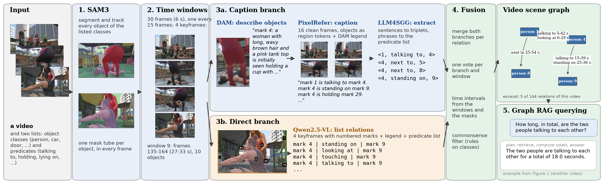

# Zero-shot video scene graphs

Code for the UGRP report *Zero-Shot Video Scene Graph Generation with Foundation Models, Applied to Construction
Site Video* (Anoushka Ranjan Kuriakos, IIT Madras, 2026). It turns a video plus two lists, object classes and
predicates, into a video scene graph (object mask tubes and time-stamped ⟨subject, predicate, object⟩ relations)
with no training, and answers plain-language questions about it.



*The pipeline on one 6-second window of a PSG4D-GTA video: SAM3 mask tubes, the time window, the caption branch
(DAM description, PixelRefer caption, extracted triplets), the direct branch (numbered-mark keyframe, Qwen2.5-VL
output), their fusion into the video scene graph, and a question answered by graph RAG. After fusion, a last step
corrects each object's class from its DAM description (`tools/relabel_dam.py`).*

## Setup

One GPU with 48 GB (24 GB works for uncrowded scenes; lower `--max-objects`). Three conda environments, because
the models need different `transformers` versions:

| env | used for | create |
|---|---|---|
| `bakeoff` | SAM3, Qwen2.5-VL (direct branch, triplet extraction, graph RAG), fusion, evaluation | `conda env create -f envs/bakeoff.yml` |
| `dam` | DAM-3B-Video object descriptions | `conda env create -f envs/dam.yml` |
| `vref` | PixelRefer-7B window captions | `conda env create -f envs/vref.yml` |

PixelRefer: clone https://github.com/alibaba-damo-academy/PixelRefer into `third_party/PixelRefer` (or set
`PIXELREFER_ROOT`) and run `python tools/fix_pixelrefer_sdpa.py` once (memory-efficient attention patch).
Model weights download from Hugging Face on first use (`facebook/sam3`, `nvidia/DAM-3B-Video`,
`Alibaba-DAMO-Academy/PixelRefer-7B`, `Qwen/Qwen2.5-VL-7B-Instruct`); `QWEN_DIR` can point to a local copy.

## Run on your own videos

1. **Write the two lists** as a config, like `configs/construction.json`: `things` (countable objects), `stuff`
   (background), optional `prompts` (SAM3 text for a class name), and `predicates`.
2. **Make the data root** (frames at 5 fps plus `sailvos3d.json`):
   ```
   python tools/make_data_root.py --config configs/mysite.json --out data/mysite --videos cam1.mp4 cam2.mp4
   ```
   It prints the `--class-list` string for step 3.
3. **Run everything** (each GPU step runs under `tools/guard.sh`, one model at a time; resumable):
   ```
   DATA=data/mysite VIDEOS="cam1 cam2" CLASSES="person,excavator,dump_truck:dump truck,ground" bash run_all.sh
   ```
   About 12 GPU-minutes per minute of video. Output: `work/graph/<video>/relations_ref.json` (relations with
   time intervals and votes) and `stsg.json` (the same with object positions per frame).
4. **Ask questions** (one per line in a text file):
   ```
   SG_OUT=work/graph python tools/graph_rag.py --video cam1 --captions work/caption --questions q.txt --backend qwen
   ```

**Very crowded videos.** If SAM3 runs out of GPU memory, run it on overlapping time ranges
(`tools/run_sam3.py --frame-range A:B`), join the chunks with `tools/stitch_chunks.py`, and put the result into the
full masks with `tools/merge_sam3.py --mode replace` before step 3. In the report this was needed for one video.

**Alignment prompt.** `parse_relations.py` uses one worked example (the setting in the report); `ALIGN_EXAMPLES=all`
uses every LLM4SGG example that fits your predicate list.

`FILTER=--plausible` adds the commonsense filter (`plausible.py`); its rules are written for the PSG4D-GTA
classes, so leave it off for other domains or write rules for yours.

## Files

| file | step |
|---|---|
| `tools/make_data_root.py` | your videos and lists → data root |
| `tools/run_sam3.py` | SAM3 segmentation and tracking from the class list |
| `make_windows.py` | 30-frame windows, objects per window |
| `describe_dam.py` | one DAM description per tube |
| `pixelrefer_caption.py` | window captions with objects as region tokens (prompt v3) |
| `extract_relations.py`, `parse_relations.py` | LLM4SGG-style triplet extraction and predicate alignment |
| `som_render.py`, `tools/vlm_direct.py` | numbered-mark keyframes; direct branch |
| `tools/make_hybrid.py`, `fuse_relations.py`, `plausible.py` | fusion into one graph; optional filter |
| `tools/relabel_dam.py` | last step: relabel each object tube from its DAM description (`--merge` also merges duplicate tubes; off by default) |
| `tools/export_stsg.py` | graph with object positions and relation times |
| `tools/graph_rag.py` | question answering over the graph |
| `run_pipeline.sh`, `run_all.sh` | drivers |
| `tools/eval_pvsg.py` | PVSG/PSG4D Recall@K (only for data with relation labels) |
| `tools/build_construction_root.py`, `tools/construction_metrics.py` | the construction example: Earthmoving data set → data root; equipment activities from the graph |
| `sgcore.py`, `common.py`, `relcommon.py`, `vlm_backends.py`, `motion.py`, `eval_relations.py`, `render_compare.py`, `tools/guard.sh`, `tools/evict_cache.py`, `tools/stitch_chunks.py`, `tools/showcase_qa.py` | shared helpers |

## Reproducing the report

* **PSG4D-GTA:** download the 13 validation videos of SAIL-VOS 3D / PSG4D-GTA (data root = `images/`,
  `sailvos3d.json`, ground-truth masks), use `configs/psg4d_gta.json`, run `run_all.sh` with
  `FILTER=--plausible`, then `bash run_pipeline.sh eval` style scoring with
  `SG_OUT=work/graph python tools/eval_pvsg.py --data-root $DATA --videos ... --paths ref`. Reported: Recall@100 46.34.
* **Construction:** `tools/build_construction_root.py` on the Earthmoving Equipment data set (Roberts and
  Golparvar-Fard 2019, Mendeley 10.17632/fyw6ps2d2j.1), then `run_all.sh` without the filter and
  `tools/construction_metrics.py`.

Numbers can differ slightly between runs: the direct branch and DAM sample at temperature 0.2.
